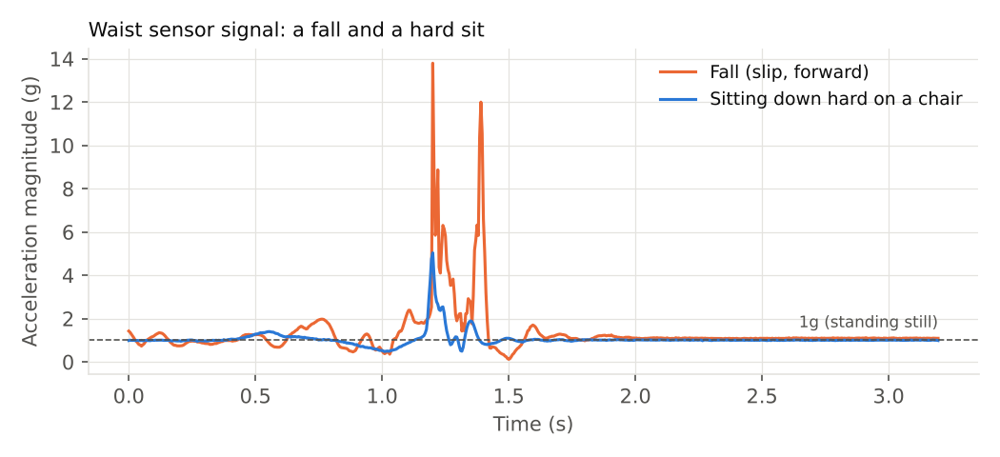
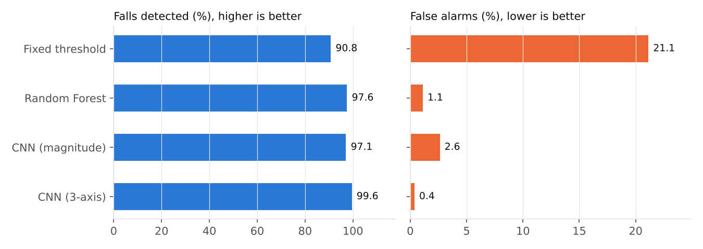
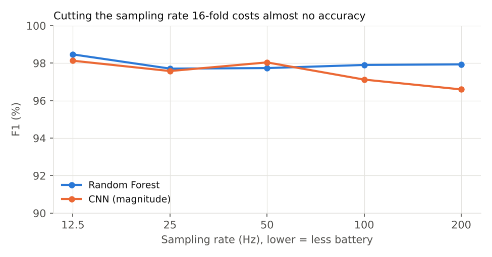
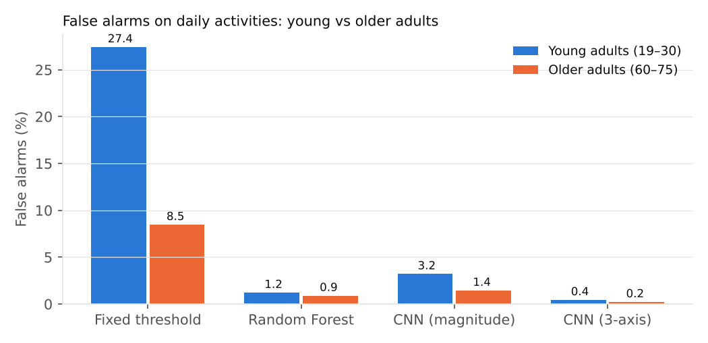
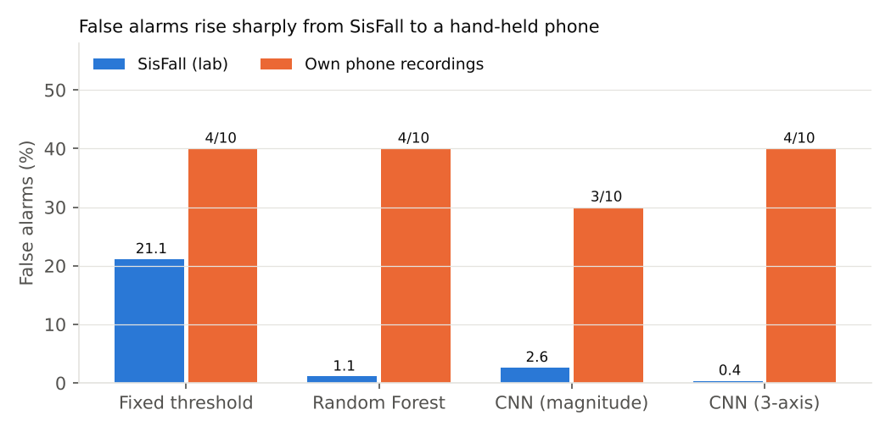

# Phát hiện ngã cho người cao tuổi bằng cảm biến gia tốc đeo ở thắt lưng

*[English version](../README.md)*

**Fall detection for older adults with a waist-worn accelerometer: model comparison, sampling-rate reduction and age-group false alarms**

> **Abstract.** Wearable fall detectors are only useful if they catch falls *and* rarely raise false alarms, otherwise users stop wearing them. Using the public SisFall dataset (38 participants, 4,505 recordings, 23 young adults and 15 older adults), I compare a fixed-threshold baseline, a Random Forest on orientation-independent features and two 1D-CNNs, evaluated with subject-wise 5-fold cross-validation. The Random Forest detects 97.6% of falls with a 1.1% false-alarm rate, about 20× fewer false alarms than the threshold baseline (21.1%), and keeps the same accuracy when the sampling rate is reduced 16-fold (200 Hz → 12.5 Hz), which matters for battery life. Contrary to my hypothesis, false alarms were not higher for older adults, even when comparing only activities performed by both groups. Finally, a pilot test on 19 recordings made with a hand-held phone (9 simulated falls onto a mattress, 10 daily activities) exposed a large gap: false alarms rose from 0.4–2.6% on SisFall to 3–5 out of 10 everyday activities, mostly when sitting down hard. Because the phone was held in the hand rather than worn at the waist, this gap mixes a change of device with a change of sensor position.

---

## 1. Vấn đề

Ngã là một trong những nguyên nhân hàng đầu gây chấn thương ở người cao tuổi, và nguy hiểm nhất khi họ ở nhà một mình: có thể nằm nhiều giờ mà không ai biết. Đồng hồ thông minh và điện thoại đều có cảm biến gia tốc, nên về lý thuyết có thể tự động phát hiện ngã và gọi người thân.

Cái khó không nằm ở việc phát hiện ngã, mà ở **báo động giả**: ngồi phịch xuống ghế hay nhảy lên với đồ cũng tạo ra cú sốc giống ngã. Thiết bị báo nhầm quá nhiều thì người dùng sẽ tháo ra và không đeo nữa.

## 2. Câu hỏi nghiên cứu

| | Câu hỏi |
|---|---|
| **RQ1** | Mô hình học máy giảm báo động giả bao nhiêu so với cách "vượt ngưỡng gia tốc là ngã" mà nhiều thiết bị đơn giản đang dùng? |
| **RQ2** | Có thể giảm tần số lấy mẫu (để tiết kiệm pin) đến mức nào mà không mất độ chính xác? |
| **RQ3** | Mô hình có báo động giả nhiều hơn với **người cao tuổi** không? Lo ngại này xuất phát từ việc dữ liệu ngã gần như chỉ do người trẻ thực hiện. |
| **RQ4** | Mô hình train trên dữ liệu phòng thí nghiệm có dùng được trên điện thoại thật không? |

## 3. Dữ liệu

[SisFall](https://www.ncbi.nlm.nih.gov/pmc/articles/PMC5298771/) (Sucerquia và cộng sự, 2017): cảm biến gia tốc ADXL345 đeo ở thắt lưng, lấy mẫu 200Hz.

| | Số người | Hoạt động thường | Ngã |
|---|---|---|---|
| Người trẻ (19–30 tuổi) | 23 | 1.809 | 1.723 |
| Người cao tuổi (60–75 tuổi) | 15 | 898 | 75 |
| **Tổng** | **38** | **2.707** | **1.798** |

Gồm 19 loại hoạt động thường (đi bộ, chạy, lên xuống cầu thang, ngồi, nằm…) và 15 kiểu ngã (trượt, vấp, ngất…). Chỉ 1 người cao tuổi (SE06) thực hiện ngã, và cũng chỉ người này làm 4 hoạt động mạnh: lên xuống cầu thang nhanh (D06), nằm xuống nhanh (D13), vấp khi đi (D18), nhảy nhẹ (D19).



*Hình 1. Một cú ngã có đỉnh va chạm ~14g kèm nhiều dao động; ngồi phịch xuống ghế chỉ tạo đỉnh ~5g.*

## 4. Phương pháp

**Tiền xử lý.** Đổi giá trị thô sang đơn vị g; với mỗi bản ghi, cắt một cửa sổ 3,2 giây quanh thời điểm gia tốc tổng lớn nhất (1,2 giây trước, 2 giây sau). Với hoạt động thường, đây là khoảnh khắc "giống ngã nhất", nên mô hình được kiểm tra ở tình huống khó nhất.

**Mô hình.**
1. **Ngưỡng cố định** (baseline): ngã nếu gia tốc tổng vượt ngưỡng T; T được chọn trên tập train để cân bằng độ nhạy và độ đặc hiệu.
2. **Random Forest** (300 cây) trên 10 đặc trưng **không phụ thuộc hướng đeo thiết bị**: thống kê độ lớn gia tốc, mức "rơi tự do" trước va chạm, độ dao động sau va chạm, góc thay đổi tư thế (hướng trọng lực trước và sau), tỉ lệ thời gian vượt 2g.
3. **1D-CNN** (4 khối tích chập) trên tín hiệu thô, 2 biến thể: dùng **cả 3 trục** (`xyz`) và chỉ dùng **độ lớn gia tốc** (`mag`, không phụ thuộc hướng đeo).

**Đánh giá.** Kiểm định chéo 5-fold **theo người** (GroupKFold): mỗi người chỉ được dự đoán bởi mô hình chưa từng thấy dữ liệu của người đó. Chia ngẫu nhiên theo bản ghi sẽ để cùng một người nằm ở cả train và test, khiến kết quả cao giả tạo.

Chỉ số: **độ nhạy** (% cú ngã phát hiện được), **báo động giả** (% hoạt động thường bị báo nhầm = 1 − độ đặc hiệu), F1.

## 5. Kết quả

### RQ1: Học máy so với ngưỡng cố định

| Mô hình (200Hz) | Phát hiện ngã | Báo động giả | F1 |
|---|---|---|---|
| Ngưỡng cố định | 90,8% | 21,1% | 0,816 |
| Random Forest | 97,6% | 1,1% | 0,979 |
| CNN (độ lớn) | 97,1% | 2,6% | 0,966 |
| CNN (3 trục) | **99,6%** | **0,4%** | **0,995** |



Random Forest giảm báo động giả khoảng **20 lần** so với ngưỡng cố định trong khi phát hiện được nhiều cú ngã hơn. CNN 3 trục tốt nhất trên SisFall, nhưng dựa vào hướng các trục nên có thể nhạy cảm với cách đeo thiết bị (xem RQ4).

### RQ2: Giảm tần số lấy mẫu

| Tần số | Random Forest F1 | CNN (độ lớn) F1 |
|---|---|---|
| 200Hz | 0,979 | 0,966 |
| 100Hz | 0,979 | 0,971 |
| 50Hz | 0,977 | 0,980 |
| 25Hz | 0,977 | 0,976 |
| 12,5Hz | **0,985** | **0,981** |



Giảm tần số **16 lần** (200Hz → 12,5Hz) không làm giảm độ chính xác. Với thiết bị đeo, lấy mẫu thưa hơn giúp giảm điện năng của cảm biến và bộ xử lý.

### RQ3: Người trẻ và người cao tuổi

| Mô hình | Báo động giả: trẻ | Báo động giả: cao tuổi | Chỉ tính hoạt động cả hai nhóm đều làm: trẻ | … cao tuổi |
|---|---|---|---|---|
| Ngưỡng cố định | 27,4% | 8,5% | 13,6% | 7,0% |
| Random Forest | 1,2% | 0,9% | 1,5% | 0,9% |



**Giả thuyết không được xác nhận:** người cao tuổi không bị báo nhầm nhiều hơn, kể cả khi bỏ 4 hoạt động mạnh chỉ một người cao tuổi thực hiện. Cách giải thích hợp lý là người cao tuổi cử động nhẹ nhàng hơn nên ít tạo cú sốc giống ngã. Chênh lệch lớn ở phương pháp ngưỡng chủ yếu đến từ các hoạt động mạnh của người trẻ.

**Hoạt động hay bị Random Forest nhầm là ngã nhất:** "cố đứng dậy rồi ngồi phịch xuống ghế" (D11, 8,4%) và "trở mình khi nằm" (D14, 6,3%). Cả hai đều có va chạm mạnh kèm thay đổi tư thế, giống hệt một cú ngã.

### RQ4: Thử trên điện thoại thật

Tôi tự ghi dữ liệu bằng app phyphox trên iPhone **cầm trên tay** (thí nghiệm "Acceleration with g", 100Hz, nội suy lên 200Hz cho giống SisFall): **9 lần ngã giả lập xuống nệm** và **10 hoạt động thường** (3 lần nằm xuống, 3 lần ngồi xuống, 4 đoạn đi bộ). Một bản ghi ngã bị loại vì ghi nhầm cảm biến từ trường thay vì gia tốc. Các mô hình giữ nguyên như khi train trên SisFall, không chỉnh thêm gì.

| Mô hình | Phát hiện ngã | Báo động giả trên điện thoại | Báo động giả trên SisFall |
|---|---|---|---|
| Ngưỡng cố định | 9/9 | 4/10 | 21,1% |
| Random Forest 200Hz | 7/9 | 4/10 | 1,1% |
| Random Forest 12,5Hz | 8/9 | 4/10 | 0,7% |
| CNN (độ lớn) 200Hz | 6/9 | 3/10 | 2,6% |
| CNN (độ lớn) 12,5Hz | 7/9 | 5/10 | 0,9% |
| CNN (3 trục) 200Hz | 9/9 | 4/10 | 0,4% |



**Kết quả trên phòng thí nghiệm không chuyển sang được đời thực.** Báo động giả tăng từ khoảng 1% lên 30–50%. Bản ghi "ngồi xuống" đầu tiên bị **cả 4 mô hình chính** báo nhầm là ngã. Ngồi phịch xuống ghế tạo đỉnh 5–6g, cũng chính là hoạt động khó nhất trên SisFall (D11). Đi bộ ít bị nhầm hơn: mỗi mô hình nhầm nhiều nhất 1 trong 4 đoạn đi bộ. Mô hình 3 trục vẫn phát hiện 9/9 cú ngã, nhưng với điện thoại cầm tay thì chưa thể kết luận gì về ảnh hưởng của hướng đeo.

Mẫu rất nhỏ (19 bản ghi, 1 người), nên các tỉ lệ này chỉ là ước lượng thô: 4/10 có thể nằm đâu đó trong khoảng 15–70%. Dù vậy, khoảng cách với con số ~1% trên SisFall đủ lớn để kết luận rằng **cần đánh giá trên thiết bị thật trước khi tin vào độ chính xác báo cáo trên bộ dữ liệu**. Nguyên nhân lớn nhất có lẽ là **vị trí cảm biến**: SisFall đeo ở thắt lưng, còn tôi cầm điện thoại trên tay, nên chuyển động của tay (vung tay khi đi, chống tay khi ngồi) được cộng thêm vào tín hiệu. Ngoài ra cảm biến điện thoại khác ADXL345, và tôi có thể ngồi mạnh hơn người tham gia SisFall. Thí nghiệm tiếp theo là ghi lại với điện thoại đeo ở thắt lưng để tách riêng ảnh hưởng của vị trí.

## 6. Hạn chế

- **Ngã giả lập, không phải ngã thật**, và gần như chỉ do người trẻ thực hiện (1/15 người cao tuổi). Đây là hạn chế chung của hầu hết bộ dữ liệu ngã.
- Mỗi bản ghi chỉ lấy **một cửa sổ quanh đỉnh va chạm**; thiết bị thật phải xử lý tín hiệu liên tục, nên tỉ lệ báo động giả thực tế (tính theo giờ đeo) có thể khác.
- Chỉ dùng **một bộ dữ liệu, một vị trí cảm biến** (thắt lưng).
- Mới chạy 1 seed cho mỗi cấu hình; chưa có khoảng tin cậy.
- Thử nghiệm điện thoại chỉ có 19 bản ghi của 1 người, ngã giả lập xuống nệm, và điện thoại **cầm tay** chứ không đeo ở thắt lưng như SisFall.

## 7. Hướng phát triển

- **Thu hẹp khoảng cách phòng thí nghiệm và đời thực:** thêm vài phút dữ liệu hoạt động thường của chính người dùng để tinh chỉnh mô hình (cá nhân hóa), hoặc train thêm trên dữ liệu điện thoại.
- Đánh giá trên tín hiệu liên tục và đo **số báo động giả mỗi giờ đeo**.
- Kiểm tra trên bộ dữ liệu khác (vị trí cổ tay, cảm biến khác) để đo khả năng tổng quát hóa.
- Thêm thông tin "sau ngã có nằm yên không" trong khoảng thời gian dài hơn để giảm nhầm với D11 và D14.
- Chạy mô hình nhỏ trực tiếp trên vi điều khiển hoặc đồng hồ.

## 8. Chạy lại thí nghiệm

```bash
pip install torch
pip install -r requirements.txt
python prepare_sisfall.py --root <thư mục SisFall_dataset>
bash run_all.sh                 # 12 thí nghiệm, bảng kết quả trong results/results_table.md
python predict_phone.py --dir phone_data --model results/rf_200hz.pkl   # lặp lại với từng mô hình
python make_figures.py          # thêm hình 5 nếu đã có kết quả điện thoại
```

Phân tích bằng KNIME: [KNIME.md](KNIME.md).

## Tài liệu tham khảo

Sucerquia, A., López, J. D., & Vargas-Bonilla, J. F. (2017). SisFall: A Fall and Movement Dataset. *Sensors*, 17(1), 198.
